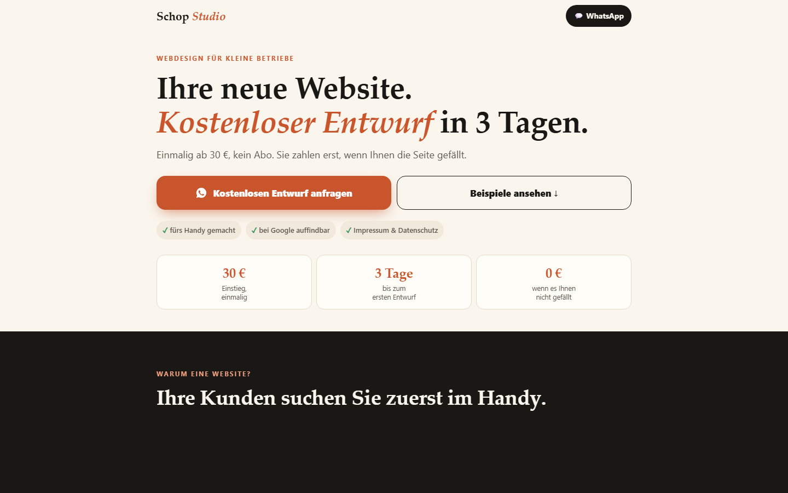
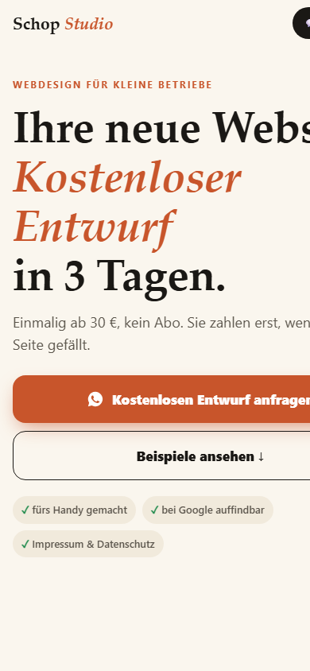
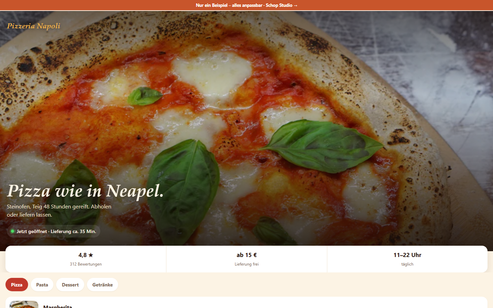

# Schop Studio — web design for small businesses

**Live:** https://schop-studio.netlify.app

**EN** · Landing page of my small web-design offer for local businesses in Germany, plus 12 demo sites (pizzeria, café, barber, florist, goldsmith with a 3D ring, workshop…). Plain HTML/CSS/JS, mobile first, no frameworks, hosted on Netlify.

**DE** · Landingpage meines kleinen Webdesign-Angebots für lokale Betriebe, dazu 12 Demo-Seiten (Pizzeria, Café, Barbier, Blumenladen, Goldschmiede mit 3D-Ring, Werkstatt …). Reines HTML/CSS/JS, für das Handy gebaut, ohne Frameworks, gehostet auf Netlify.

| Landing | Mobile | Demo: Pizzeria |
|---|---|---|
|  |  |  |

## What is inside

- `index.html` — the landing page (offer, prices, demo gallery, WhatsApp contact)
- `demos/` — one page per business type; `_demo.js` adds the shared "this is only an example" bar
- `demos/goldschmiede.html` — a ring rendered live with three.js (`demos/vendor/`)
- `go.html` — personal links: `?f=<business>&b=<type>` opens the matching demo with the business name filled in, used for outreach
- `img/` — WebP images, `img/t/` thumbnails
- `impressum.html`, `datenschutz.html` — legal pages required in Germany

## Run locally

Any static server, e.g.

```bash
python -m http.server 8000
```
